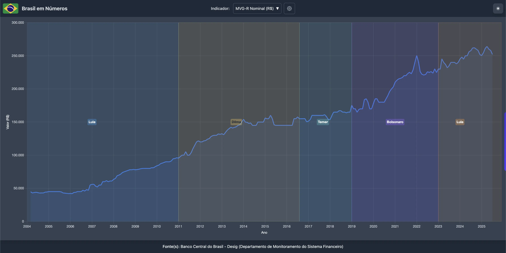
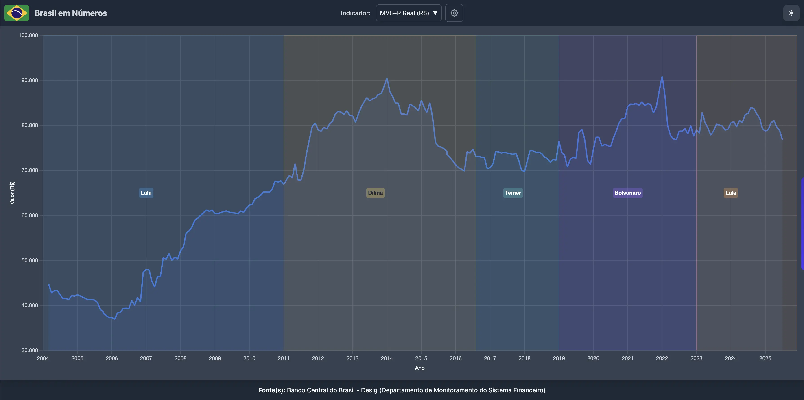

### Por que o valor real dos imóveis, descontado da inflação, conta uma história muito diferente do preço que você vê na vitrine.

Para quem acompanha o mercado imobiliário brasileiro, seja para comprar, vender ou simplesmente entender o valor de seu patrimônio, a percepção é frequentemente de uma alta implacável nos preços. Indicadores como o **MVG-R (Mediana de Valor de Garantia - Residencial)**, **que representa o valor médio de imóveis residenciais usados como garantia em financiamentos bancários e é calculado pelo Banco Central**, parecem confirmar isso. Um olhar rápido no gráfico nominal mostra os valores medianos saltando de R$ 44.419 em março de 2004 para R$ 290.000 em agosto de 2026.

Mas será que os imóveis realmente "explodiram" de valor, tornando-se inatingíveis para muitos? Ou estamos sendo vítimas de uma ilusão causada pela inflação, que distorce nossa percepção sobre o preço das coisas?

Uma análise crítica de dois indicadores — o MVG-R nominal e o MVG-R real (descontado do IPCA) — ajuda a ler o que está por trás desses números. E a história que eles contam é vital para qualquer cidadão que deseja compreender o valor real de um dos maiores investimentos da vida: a casa própria.

### A Ilusão do Preço na Etiqueta

O primeiro indicador, o MVG-R nominal, reflete o "preço de etiqueta" dos imóveis ao longo do tempo. Ele mostra o valor mediano exato que foi registrado nas garantias de financiamento, em Reais (R$) correntes de cada ano.

Como podemos ver no gráfico abaixo, a trajetória é uma subida quase ininterrupta. Para quem olha esta imagem, a conclusão é simples: o mercado está sempre em alta e os preços nunca param de subir.

_(Gráfico mostrando a curva ascendente do valor nominal, de R$ 44.419 a R$ 290.000)_

<a href="https://www.brasilemnumeros.ong.br/?series=mvgr-nominal" class="text-blue-600 hover:text-blue-800 underline">Acesse o gráfico do MVG-R Nominal aqui!</a>

A crítica a esta visão, contudo, é fundamental: ela é enganosa. Grande parte dessa escalada nos preços não é uma valorização real do imóvel em si, mas sim a **desvalorização da moeda (o Real)** ao longo de duas décadas de inflação. Em outras palavras, um imóvel que "subiu de preço" nominalmente pode, na verdade, ter mantido ou até perdido seu valor real de compra.

### A Verdade Revelada pelo MVG-R Real

Para entender o que de fato aconteceu com o valor dos imóveis, precisamos "limpar" o efeito da inflação. É exatamente isso que o segundo indicador, o MVG-R Real (descontado do IPCA), faz. Ele recalcula todos os valores medianos para um poder de compra constante, em **reais de março de 2004** — o mês-base é o primeiro da série. É por isso que o número real é sempre menor que o nominal: são reais de 2004, não de hoje.

Quando plotamos este gráfico, o cenário muda drasticamente. A linha reta ascendente desaparece e dá lugar ao que realmente move o mercado: **ciclos econômicos claros de valorização e desvalorização real**.

_(Gráfico mostrando a curva cíclica do valor real, em reais de março de 2004, com picos em 2014 e 2022 e vales em 2006 e 2019, começando em R$ 44.419 e terminando em R$ 86.269)_

<a href="https://www.brasilemnumeros.ong.br/?series=mvgr-real" class="text-blue-600 hover:text-blue-800 underline">Acesse o gráfico do MVG-R Real aqui!</a>

### Decifrando os 4 Ciclos Reais do Mercado Imobiliário

Este segundo gráfico é a ferramenta correta para qualquer um que deseja compreender a dinâmica do mercado de imóveis. Analisando-o, podemos identificar quatro fases distintas do mercado brasileiro desde 2004:

1.  **A "Década de Ouro" (2004 - Jan 2014):** Este foi o verdadeiro boom do setor. Impulsionado por crédito imobiliário mais acessível e um período de forte crescimento econômico, o valor real mediano dos imóveis mais do que dobrou, saindo de R$ 44.419 para um pico histórico de R$ 91.743. Quem comprou ou tinha imóveis aqui viu seu patrimônio crescer muito acima da inflação.

2.  **A Longa Correção (2014 - 2019):** Após o pico, o mercado entrou em uma severa correção. Mesmo que os preços nominais parecessem estáveis ou subindo levemente em alguns anos, a alta da inflação estava comendo o valor. Na prática, o valor real dos imóveis caiu consistentemente por cinco anos, chegando a um vale de aproximadamente R$ 70.000 a R$ 72.000.

3.  **O "Mini-Boom" da Pandemia (2020 - Jan 2022):** Com a taxa Selic (juros básicos da economia) em mínimas históricas (2%), o mercado ganhou um novo fôlego. A procura por moradia aqueceu e os preços reais dispararam novamente, atingindo um segundo pico de R$ 92.259 — o maior de toda a série, R$ 516 acima do pico de 2014.

4.  **A Segunda Correção e a Retomada (2022 - Presente):** Com a subida dos juros para combater a inflação, o valor real começou a cair em 2022 e chegou ao fundo em **novembro de 2025, com R$ 78.471** — cerca de 15% abaixo do pico. Desde então o indicador voltou a subir: em agosto de 2026 está em **R$ 86.269**, o maior valor desde fevereiro de 2022 e ~10% acima do fundo. O patamar atual é de recuperação, ainda 6,5% abaixo do pico.

### Conclusão: O Que os Preços Reais Revelam

A análise comparativa sugere duas leituras possíveis para quem acompanha o mercado imobiliário — e não é recomendação de compra ou de venda:

- **O Preço Nominal é Ruído, o Preço Real é o Sinal:** Para qualquer análise séria sobre a valorização de um imóvel ou sobre a existência de uma "bolha", olhar apenas para o preço nominal é enganoso. O que realmente importa é o valor real, que mostra o poder de compra e o crescimento efetivo do seu patrimônio.

- **O Mercado Não Está no "Pico":** Ao contrário do que o gráfico nominal sugere com sua curva ascendente constante, o mercado imobiliário brasileiro não está em sua máxima histórica em termos de poder de compra. Em termos de valor real, os preços estão **6,5% abaixo do pico de 2022** (R$ 86.269 contra R$ 92.259) e em um patamar semelhante ao que víamos em meados de 2013 — depois de terem caído quase 15% no fundo de 2025 e recuperado parte disso.

Para quem sonha com a casa própria, busca trocar de imóvel ou simplesmente quer entender o valor do seu patrimônio, a mensagem é que o mercado, neste momento, mostra um desaquecimento e uma fase de correção de preços reais. É um convite à análise mais aprofundada antes de tomar grandes decisões.

---

[**Confira nossos outros artigos!**](https://www.brasilemnumeros.ong.br/blog)
