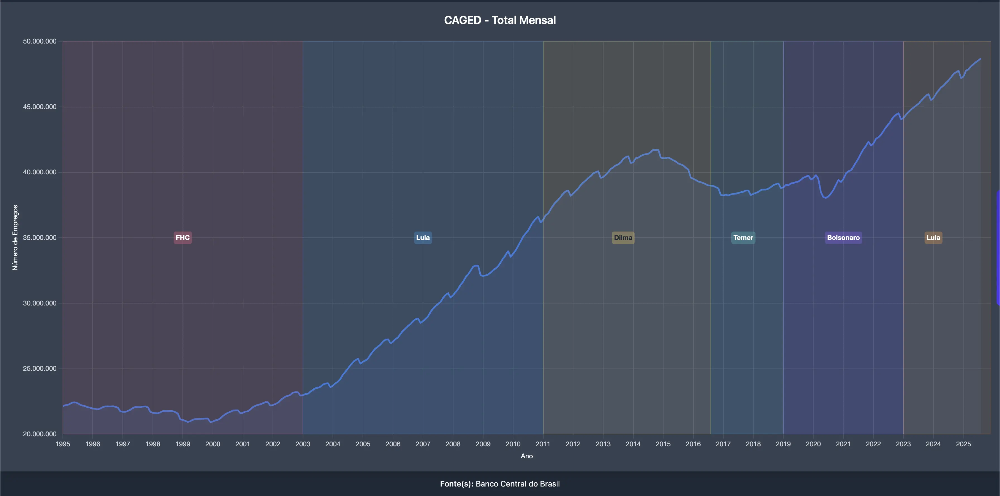
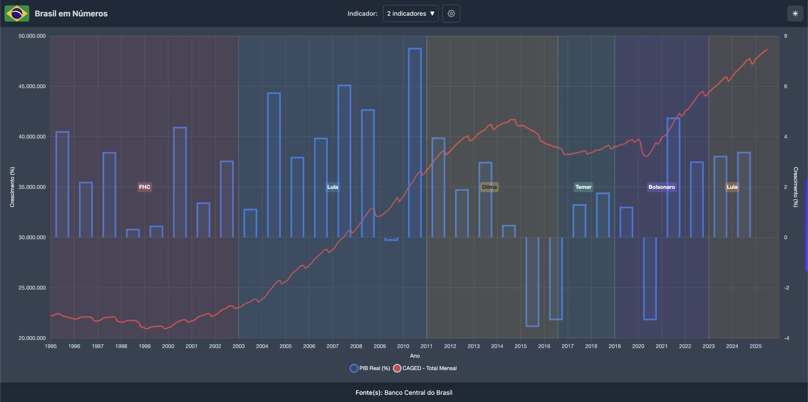

### Entenda o que o número total de carteiras assinadas nos diz sobre a economia e seu impacto no dia a dia.

No "Brasil em Números", estamos sempre buscando trazer indicadores que ajudem você a compreender melhor o cenário do país. E hoje, temos uma novidade que fala diretamente sobre a vida de milhões de brasileiros: o <a href="https://www.brasilemnumeros.ong.br/?series=caged-total-mensal" target="_blank" rel="noopener noreferrer" class="text-blue-600 hover:text-blue-400 underline"><strong>Estoque de Empregos Formais</strong></a>.

### O Que é o Estoque de Empregos Formais (Novo CAGED)?

Pense no Estoque de Empregos Formais como uma **"contagem total"** de todas as pessoas que estão trabalhando com carteira assinada no Brasil em um determinado momento. Ao contrário do saldo mensal (que mostra apenas quantas vagas foram criadas ou perdidas no mês), o estoque é a **soma acumulada** de todos esses empregos formais.

**Em outras palavras:**

- Ele não mostra "vagas abertas", mas sim **posições de trabalho formal que estão efetivamente ocupadas**.
- É o retrato do tamanho do mercado de trabalho com carteira assinada em nosso país.

Esses dados são compilados pelo Ministério do Trabalho e Emprego, utilizando as informações enviadas pelas empresas através do eSocial (que modernizou o antigo sistema CAGED).

### Por Que Esse Indicador é Tão Importante?

O Estoque de Empregos Formais é um dos termômetros mais confiáveis da saúde econômica de um país. Veja por que ele é crucial:

1.  **Reflete a Atividade Econômica:** Quando a economia vai bem, as empresas produzem mais, vendem mais e precisam contratar. Isso faz o estoque de empregos formais crescer. Em momentos de crise, o inverso acontece.

2.  **Segurança e Qualidade de Vida:** Um estoque maior de empregos formais significa mais pessoas com acesso a direitos trabalhistas, previdência social e maior estabilidade financeira, o que impacta diretamente a qualidade de vida das famílias.

3.  **Indicador de Formalização:** Mostra a evolução da formalização do trabalho no Brasil, um aspecto fundamental para o desenvolvimento social e econômico.

### O Que o Gráfico nos Revela (1995-2026)?

Ao analisarmos a série histórica do Estoque de Empregos Formais, de janeiro de 1995 até o último mês fechado, agosto de 2026, podemos traçar um panorama fascinante dos altos e baixos da nossa economia.

<a href="https://www.brasilemnumeros.ong.br/?series=caged-total-mensal" class="text-blue-600 hover:text-blue-400 underline" target="_blank" rel="noopener noreferrer">Acesse o gráfico aqui!</a>

_(Gráfico de linhas mostrando a evolução do número de empregos formais, de 20,8 milhões em 1995 para 48,2 milhões em agosto de 2026)_

**Analisando os Ciclos:**

- **Pós-Plano Real e Início dos Anos 2000 (1995-2003):** O período começa com cerca de 20,8 milhões de empregos formais. Há flutuações e até leves retrações, com momentos de dificuldade econômica que impediram um crescimento robusto.
- **"Década de Ouro" (2004-2014):** A partir de 2004, o Brasil viveu um boom de formalização. O estoque de empregos com carteira assinada saltou de cerca de 22,4 milhões para um pico de 40,4 milhões em 2014, refletindo um período de forte crescimento econômico.
- **A Grande Recessão (2015-2017):** Este foi um momento de forte contração. O estoque de empregos formais despencou de 40,4 milhões para um vale de 36,9 milhões — 3,5 milhões de postos a menos —, com milhões de brasileiros perdendo seus empregos.
- **Recuperação e Choque da Pandemia (2017-2020):** Uma recuperação lenta se iniciou, mas foi interrompida em 2020 pela pandemia de COVID-19, que causou uma queda abrupta no estoque. Contudo, a retomada foi surpreendentemente rápida a partir do segundo semestre de 2020.
- **Novo Ciclo de Expansão (2021-2026):** Desde então, o mercado de trabalho formal tem mostrado uma recuperação vigorosa, superando os níveis pré-crise e até mesmo o pico histórico de 2014. O crescimento seguiu contínuo: o estoque cruzou os 48 milhões em junho de 2026 e chegou ao máximo da série em agosto de 2026, com 48,2 milhões.

### Qual Outro Indicador Correlacionar?

Para uma análise ainda mais completa, é fascinante comparar o Estoque de Empregos Formais com o **PIB (Produto Interno Bruto)**. Essa correlação nos mostra como a atividade econômica e a geração de empregos com carteira assinada caminham lado a lado. Em geral, quando o PIB cresce, o número de empregos formais também tende a crescer, e vice-versa.

<a href="https://www.brasilemnumeros.ong.br/?series=caged-total-mensal,pib-real-anual" class="text-blue-600 hover:text-blue-400 underline" target="_blank" rel="noopener noreferrer">Acesse o gráfico comparativo aqui!</a>

### Conclusão

O **Estoque de Empregos Formais** é mais do que um número: é um indicador da resiliência do trabalhador brasileiro e da dinâmica da nossa economia. Ao acompanhar essa série, podemos entender melhor onde estamos e para onde o mercado de trabalho formal está caminhando.
