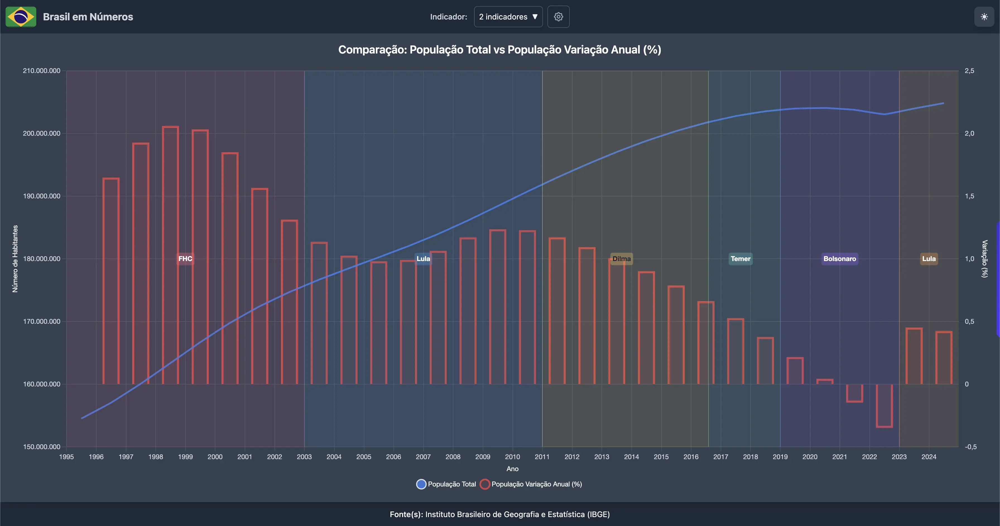

### Em 26 anos, a população passou de 174,7 para 214,2 milhões de habitantes. O que mudou não foi o tamanho do crescimento, e sim o ritmo: de 1,32% ao ano em 2001 para 0,36% em 2022, o menor da série.

No "Brasil em Números", estamos sempre de olho nos indicadores que moldam o nosso país e sua sociedade. Hoje, trazemos uma análise de um tema crucial: a **População Brasileira**. Para isso, anunciamos dois novos indicadores que estarão disponíveis em nossa plataforma: **População - Total Anual** e **População - Variação Anual (%)**.

Os dados vêm das **Projeções da População — Revisão 2024** do IBGE, com população estimada para 1º de julho de cada ano. Eles mostram um movimento claro e menos dramático do que parece à primeira vista: o Brasil **cresceu em todos os anos da série**, mas a velocidade desse crescimento caiu de forma quase contínua. Não há queda populacional em nenhum ano; há desaceleração.

### A Longa Desaceleração: O Fim do Crescimento Rápido (2000-2019)

Os dados da **População Total Anual** entre 2000 e 2019 mostram expansão contínua: o número de habitantes saltou de 174,7 milhões para 207,9 milhões — 33,2 milhões de pessoas em 19 anos. O que perde força é o motor desse crescimento.

Em 2001, a população crescia 1,32% ao ano — o maior ritmo da série. Em 2010, já era 0,82%. Em 2019, 0,66%. É a marca clássica da **transição demográfica**: urbanização, aumento da escolaridade (especialmente a feminina) e maior acesso ao planejamento familiar reduzem a natalidade de forma sustentada. O Brasil seguiu o padrão de muitas nações de renda média, vendo o ritmo de crescimento diminuir ano após ano.

<a href="https://www.brasilemnumeros.ong.br/?series=populacao-total-anual,populacao-variacao-anual" class="text-blue-600 hover:text-blue-400 underline" target="_blank" rel="noopener noreferrer">Acesse o gráfico comparativo aqui!</a>

### 2020-2022: a Pandemia Acelerou a Desaceleração — sem Reverter o Crescimento

Entre 2019 e 2022, a taxa caiu por três anos seguidos: 0,66%, 0,61%, 0,45% e, por fim, **0,36% em 2022 — o menor valor de toda a série**. Nesses quatro anos, a população ainda ganhou 3,0 milhões de habitantes (de 207,9 para 210,9 milhões).

O ano de 2021 registra a **maior queda de ritmo da série**: 0,16 ponto percentual em relação a 2020. É o período em que o excesso de mortalidade da pandemia aparece com mais força. Mas o efeito foi de desaceleração, não de reversão: 2022 termina no menor patamar da série, e não em terreno negativo.

Vale ser preciso sobre o que esta série permite concluir. Ela mostra o **resultado** demográfico de cada ano, não a causa. A queda de ritmo em 2021-2022 é compatível com o excesso de mortalidade da Covid, mas também com a trajetória de queda da fecundidade que vinha desde 2001 — e a série anual não separa uma coisa da outra.

### O Novo Normal: Estabilização em Torno de 0,4% ao Ano (2023-2026)

De 2023 em diante, o ritmo deixou de cair: 0,39% em 2023, 0,42% em 2024, 0,39% em 2025 e 0,37% em 2026. A população chega a **214,2 milhões** em 2026 — o maior valor da série —, mas o crescimento anual é cerca de **28%** do que era em 2001.

Esse é o "novo normal" demográfico brasileiro: crescimento positivo, porém baixo, e cada vez mais dependente de a mortalidade e a fecundidade se comportarem como o previsto. A diferença em relação ao passado não é o sinal da taxa, e sim a sua margem: com 0,37% ao ano, qualquer choque na mortalidade tem peso relativo muito maior do que tinha em 2001.

### O Que Isso Significa para Você?

Desaceleração demográfica tem consequências concretas — e elas não dependem de a população encolher. Uma base de crescimento menor pressiona a força de trabalho e a previdência, ao mesmo tempo em que uma população mais velha exige mais serviços de saúde e adaptações de infraestrutura. É o mesmo conjunto de desafios que um cenário de queda populacional traria, só que alguns anos à frente — e com mais tempo para se preparar.

Entender esses movimentos é fundamental para planejar políticas públicas, investimentos e até decisões pessoais, como planejamento familiar e de carreira.

### Nota sobre os dados

A série é a **Revisão 2024 das Projeções da População do IBGE**, com população a 1º de julho. Os valores de 2000 a 2022 são estimativas conciliadas ao Censo 2022: a população recenseada em 2022 foi de 203,1 milhões, e a série conciliada — que corrige a cobertura do recenseamento — registra 210,9 milhões para o mesmo ano. De 2023 em diante os valores são **projeção**, não medição.

O "Brasil em Números" continuará acompanhando de perto esses indicadores, trazendo análises e dados para que você possa se manter sempre bem informado sobre as tendências que moldam nosso país.

---

**Comente abaixo o que achou dessa análise!**
